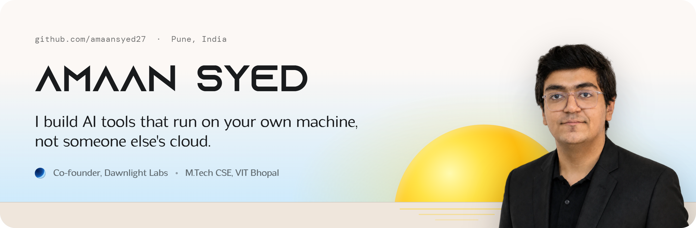
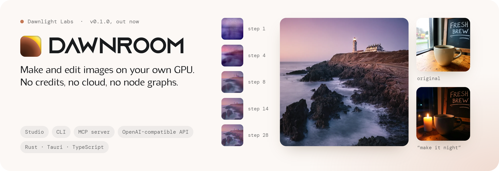
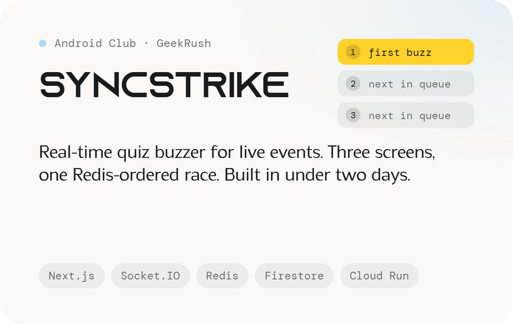
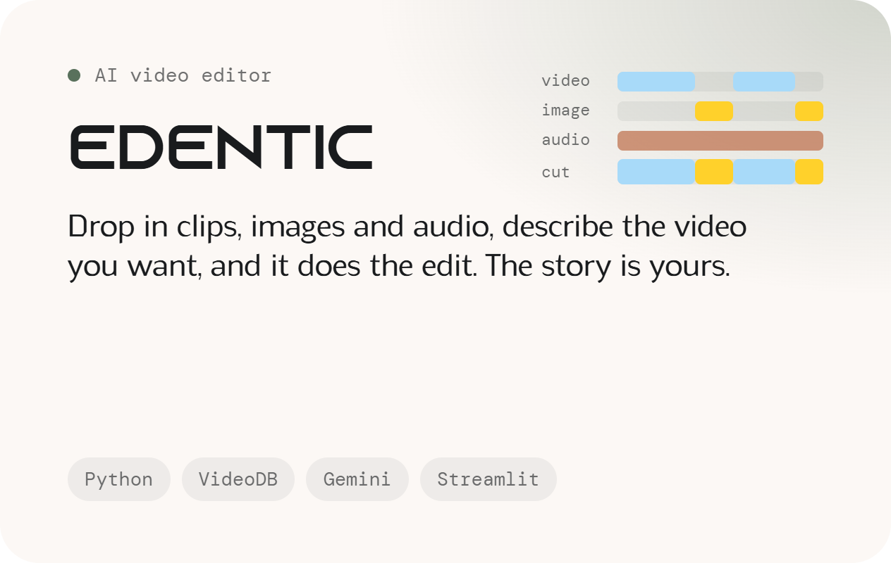

<picture>
  <source media="(prefers-color-scheme: dark)" srcset="assets/banner-dark.png">
  
</picture>

  <a href="https://www.amaansyed27.dev/">Website</a> &nbsp;·&nbsp;
  <a href="https://dawnlightlabs.com">Dawnlight Labs</a> &nbsp;·&nbsp;
  <a href="https://linkedin.com/in/amaansyed27">LinkedIn</a> &nbsp;·&nbsp;
  <a href="https://github.com/amaansyed27/amaansyed27/raw/main/amaan_resume.pdf">Résumé</a> &nbsp;·&nbsp;
  <a href="mailto:amaansyed27@gmail.com">Email</a>

### Now

I co-founded **[Dawnlight Labs](https://dawnlightlabs.com)**, a research-first lab building local-first, human-centred AI tools. Our first release, **Dawnroom**, just shipped.

Before that I interned at **VideoDB**, building agentic video-editing workflows. I'm in my fourth year of an Integrated M.Tech in CSE (Computational & Data Science) at VIT Bhopal.

### Selected work

<picture>
  <source media="(prefers-color-scheme: dark)" srcset="assets/dawnroom-dark.png">
  
</picture>

**[Dawnroom](https://github.com/DawnlightLabs/dawnroom)** &nbsp;·&nbsp; [dawnroom.dawnlightlabs.com](https://dawnroom.dawnlightlabs.com)

<picture><source media="(prefers-color-scheme: dark)" srcset="assets/syncstrike-dark.png"></picture>&nbsp;<picture><source media="(prefers-color-scheme: dark)" srcset="assets/edentic-dark.png"></picture>

**[SyncStrike](https://github.com/amaansyed27/syncstrike)** &nbsp;·&nbsp; **[Edentic](https://github.com/amaansyed27/Edentic)**

### Toolbox

<picture>
  <source media="(prefers-color-scheme: dark)" srcset="https://skillicons.dev/icons?i=rust%2Cts%2Cpy%2Creact%2Cnextjs%2Castro%2Ctauri%2Cnodejs%2Credis%2Cfirebase%2Cgcp%2Cdocker%2Ckotlin%2Cgit%2Cfigma&theme=dark&perline=15">
  
</picture>

Agentic systems · local inference · LLM pipelines · RAG · computer vision

### Recognition

- **Winner**, AI Demos × VideoDB
- **2nd place**, ML Mumbai
- **Winner**, AcWoC '25
- **Top 12**, SSOC '25
